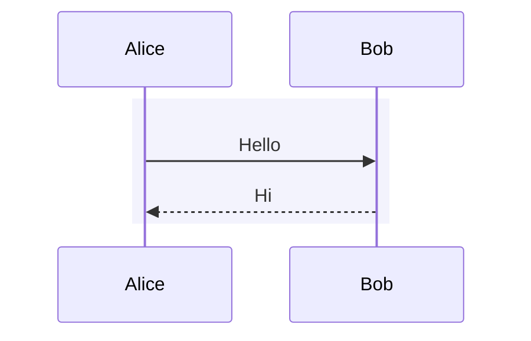
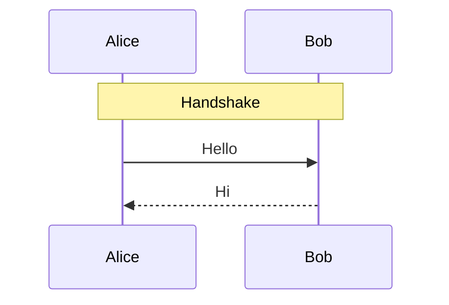

# Mermaid Walkthrough

An Obsidian plugin for stepping through the Mermaid sequence diagrams in a note one message at a time. The active message, its path and its participants are highlighted, and everything else fades out.

It has two views:

### Sequence
The diagram as a list of steps under a header of participants that stays pinned while you scroll. Phase headings pin under the participants while their steps scroll past, with any `alt`, `opt` or `loop` heading pinned just below. The current step moves to the top, so you can always see who is involved.


### Map 
The participants and their boxes as cards on a canvas, with elbow arrows between them. The current step's label sits on its arrow, with any `alt`, `opt` or `loop` it belongs to in a tab on top. The phase it is in shows in a box at the bottom left of the canvas. Drag cards and boxes into whatever layout you want. The layout is saved per diagram.


## Usage

1. Open a note that contains one or more ```` ```mermaid ```` blocks with a `sequenceDiagram`.
2. Click the ribbon icon or run **Mermaid Walkthrough: Open for current note**. The walkthrough opens in a split beside the note and follows whichever note is active.
3. Step through with the toolbar buttons or the keyboard.

Each diagram in the note gets its own tab, named after the heading above it. The walkthrough re-reads the note when you edit it.

### Keyboard

| Key | Action |
| --- | --- |
| `→` `↓` `j` | Next step |
| `←` `↑` `k` | Previous step |
| `Home` / `End` | First / last step |
| `Esc` | Show all (no step highlighted) |
| `m` | Switch between Sequence and Map |
| `1`–`9` | Switch to diagram tab |

**Next step** and **Previous step** are also commands, so you can bind them to hotkeys that work outside the pane.

### Map

- Drag a card to move it, or a box to move it together with its participants. Drag a box's corner to resize it.
- Drag empty space to pan. Pinch or Ctrl/⌘-scroll to zoom.
- **Fit** zooms to the content and **Reset layout** restores the default arrangement.

## Naming phases

Wrap related messages in a `rect` block and name it with a `%%` comment on the next line. The walkthrough shows the name as a heading over that group of steps. Mermaid ignores the comment, so the diagram still renders normally.

````markdown

````

Don't put the name after the color (`rect rgb(...) Handshake`): Mermaid reads it as part of the color and draws a black box.

A note that spans every participant, from the first to the last, also starts a phase named by its text. The phase runs until the next such note, or until the block it is in ends.

````markdown

````

`box` groups become the coloured participant groups in both views. `loop`, `alt`, `opt`, `par`, `critical` and `break` blocks show as labelled sections inside their phase. Other notes are steps like any message.

## Development

The plugin is plain JavaScript with no build step. Symlink the repo into a vault and edit in place:

```sh
ln -s "$PWD" <vault>/.obsidian/plugins/mermaid-walkthrough
```

The [Hot Reload](https://github.com/pjeby/hot-reload) plugin reloads it on save.

To release, bump `version` in `manifest.json`, add it to `versions.json`, then create a GitHub release whose tag is the version exactly (no `v` prefix) with `main.js`, `manifest.json` and `styles.css` attached.

## License

[MIT](LICENSE)
